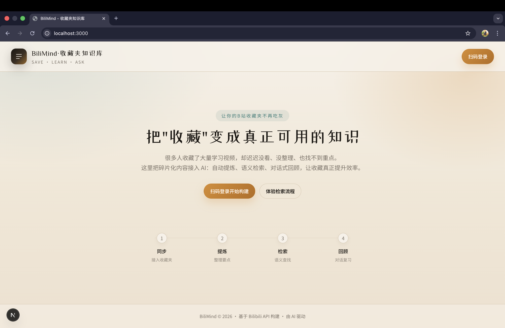
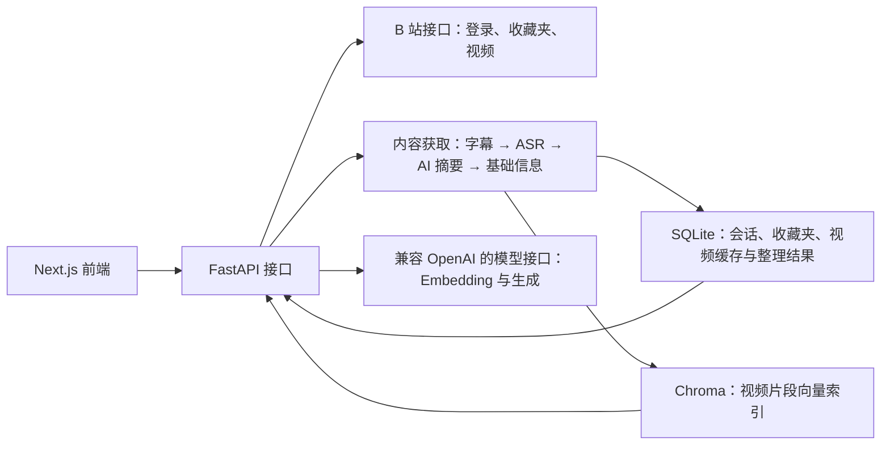

# BiliMind：把 B 站收藏夹变成可检索的知识库

BiliMind 是一个本地运行的 B 站收藏视频整理与问答原型。登录后选择收藏夹，系统同步视频信息，获取可用的字幕或转写内容，建立向量索引，再用自然语言找回视频、查看内容摘要，或针对已收藏的视频提问。回答和找回结果会尽量提供来源链接，方便回到原视频核对。

当前重点是验证“**找回相关视频与片段 → 阅读或整理内容 → 回到原视频核对**”这条流程。它仍是原型，入库质量、笔记完整性和回答准确性都需要按具体视频检查。



## 已实现的能力

| 模块 | 当前实现 |
| --- | --- |
| 登录与收藏夹 | B 站扫码登录；查看收藏夹及视频；选择收藏夹作为入库和提问范围。 |
| 收藏夹入库 | 同步收藏夹中的视频，获取内容并建立索引；前端显示任务进度，可再次点击“更新”。 |
| 内容获取 | 优先尝试字幕，其次尝试音频 ASR；都不可用时尝试 B 站 AI 摘要，最后使用标题、简介等基础信息。 |
| 内容整理 | 对可用文字稿生成摘要、关键要点及实体关系；页面展示视频摘要和知识图谱。 |
| 找回与问答 | 支持在当前用户已入库的收藏夹范围内检索；问答支持流式输出，来源列表可跳转到视频，具备时间信息时可跳转到对应片段。 |
| 笔记草稿 | 在问题中指定 1–3 条已入库视频的 BV 号，可以基于带时间轴的字幕或 ASR 文字稿生成附来源的笔记草稿。 |
| 收藏夹整理 | 可预览默认收藏夹视频的整理建议，再由用户确认执行移动；还提供清理失效内容的入口。 |

“视频摘要与知识图谱”是入库后的内容预览；它与聊天中按 BV 号生成的笔记草稿是两种不同结果。页面展示的“已同步”主要表示收藏夹视频关联已同步，不能单凭该状态判断每条视频的文字稿和向量索引都已就绪。

## 系统如何工作



后端使用 FastAPI、SQLAlchemy 和 SQLite 保存会话、收藏夹关系与视频缓存；使用 LangChain 和 Chroma 保存可检索片段。默认模型配置见 `.env.example`，包括 DashScope 的兼容接口、Embedding 和 ASR 模型。前端使用 Next.js、React 和 TypeScript。

一条视频能提供多少证据，取决于实际获取到的内容：字幕或 ASR 文字稿可以形成带时间范围的片段；AI 摘要与标题简介只提供较弱的线索，通常无法支持精确的片段定位。系统不会因为收藏夹同步成功，就自动拥有完整的视频文字稿。

## 本地运行

在 `BiliMind` 项目根目录执行以下命令。需要 Python、Node.js 与 npm；使用本地音频 ASR 兜底时，还需要将 `ffmpeg` 加入 `PATH`。入库与问答会调用外部服务，需准备可用的模型 API Key 和 B 站账号。

1. 安装后端依赖并复制配置文件：

   ```powershell
   python -m pip install -r requirements.txt
   Copy-Item .env.example .env
   ```

   在 `.env` 中填写 `DASHSCOPE_API_KEY`。示例文件已经给出模型、ASR、数据库和向量库存储位置；若改用其他兼容 OpenAI 的服务，请同时核对模型名称与接口地址。更换 Embedding 模型后，需要重建原有向量索引。

2. 启动后端：

   ```powershell
   python -m uvicorn app.main:app --host 127.0.0.1 --port 8001 --reload
   ```

   API 文档：<http://127.0.0.1:8001/docs>；健康检查：<http://127.0.0.1:8001/health>。

3. 新开终端，启动前端：

   ```powershell
   Set-Location frontend
   npm ci
   npm run dev
   ```

   打开 <http://localhost:3000>。前端默认连接 `http://127.0.0.1:8001`；若后端使用其他地址，在启动前设置 `NEXT_PUBLIC_API_URL`，并重启前端。

4. 扫码登录，先选择一个较小的收藏夹，点击“入库”，等待任务完成。随后可以试着询问“哪个视频讲了某个主题？”，或针对具体视频提问。要生成笔记草稿，在问题中写明已入库视频的 BV 号，并检查回答中的来源链接与原片段。

运行时的 SQLite 数据库、Chroma 索引和日志默认分别位于项目根目录下的 `data/` 与 `logs/`。这些文件保存本地运行状态，请按自己的数据管理需求处理。

## 接口与代码位置

| 位置 | 作用 |
| --- | --- |
| `app/routers/auth.py` | 二维码登录与会话接口。 |
| `app/routers/favorites.py` | 收藏夹、视频及整理操作。 |
| `app/routers/knowledge.py` | 收藏夹同步、知识库构建、状态与视频整理结果。 |
| `app/routers/chat.py` | 找回、笔记草稿、问答与片段搜索。 |
| `app/services/content_fetcher.py`、`app/services/asr.py` | 视频内容获取与音频转写。 |
| `app/services/rag.py` | 摘要和实体关系提取、分块、索引与检索。 |
| `frontend/` | 登录、收藏夹选择、聊天和视频整理结果页面。 |

主要接口可在 FastAPI 的 `/docs` 中查看。`POST /chat/ask` 返回完整回答，`POST /chat/ask/stream` 用于前端流式输出；`POST /chat/search` 提供独立片段搜索接口。找回与笔记支持请求中的 `task` 字段，前端当前主要通过问题用词自动选择任务；生成笔记时可在问题中写 BV 号，也可在 API 请求中使用 `video_bvids`。

## 当前限制

- **笔记是草稿。** 它要求视频有带时间轴的字幕或 ASR 文字稿；每次最多处理 3 条视频。文字稿过长时只抽取部分片段，回答会标明“部分内容笔记草稿”，不能视为完整笔记。
- **证据强度不一致。** AI 摘要、标题和简介可能支持视频级线索，却不足以证明视频中的具体说法；ASR 也可能转写错误。关键结论应打开来源核对。
- **聊天界面显示历史消息，但请求未传入历史轮次。** 目前应按单轮问题使用；后一轮若依赖前文，请在问题中重新写明视频、主题或范围。
- **当前没有外部网页资料对照。** “视频现在是否仍然适用”这类时效性问题，不能把当前回答当作已完成的在线查证。
- **部署边界仍待完善。** 当前会话凭据存储、访问控制和构建任务状态更适合本地原型；不要直接按现状公开部署。

产品目标、评测方法与后续阶段见[产品与开发计划](总体设计/01产品与开发计划.md)；架构探索记录见[架构构想草案](总体设计/00架构构想草案.md)。
