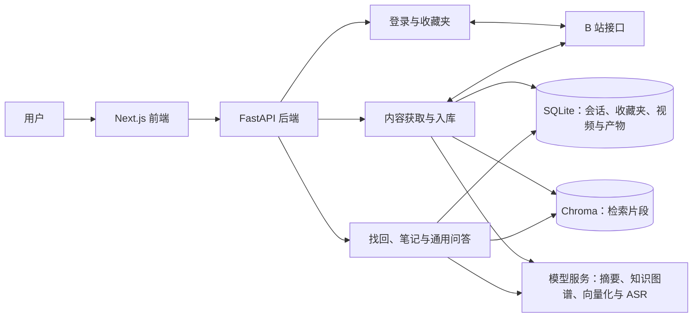

# BiliMind：B 站收藏视频知识库

BiliMind 将已收藏的学习视频整理为可检索的本地知识库，帮助用户找回相关视频和片段，并基于选中视频的文字稿生成可回看来源的笔记草稿。

> 项目处于本地原型阶段。本文区分当前代码已实现的能力和待验证的产品目标；早期设想见 [架构构想草案](总体设计/00架构构想草案.md)。

## 产品定位

**目标用户**：收藏技术学习视频的大学生和开发者。首个验证样本是项目负责人自己的 B 站收藏。

**核心问题**：收藏数量增加后，用户记得学过或收藏过某个主题，却难以找回具体视频与片段；复习时又不想逐条重看视频。

**优先任务**：输入主题，找到相关收藏视频及可跳转片段；选定一条或多条视频后，得到能核对原片段的文字笔记。例如“我收藏的哪些视频谈过近期 AI 发展趋势？”应先返回收藏范围内的视频和片段，再由用户指定要整理的内容。核对“现在的趋势”需要外部资料，属于后续阶段。

当前已实现找回与笔记草稿的后端问答分支；前端尚未把“找回 → 选视频 → 生成笔记”做成连续操作。目标用户与任务依据目前仍是个人样本，未经过外部用户验证。产品假设与阶段安排见 [产品与开发计划](总体设计/01产品与开发计划.md)、[用户研究与任务验证](开发记录/02用户研究与任务验证.md)。

## 系统架构

后端的 [认证](../app/routers/auth.py)、[收藏夹](../app/routers/favorites.py)、[知识库](../app/routers/knowledge.py)和[问答](../app/routers/chat.py)路由分别处理接口请求。[内容获取器](../app/services/content_fetcher.py)按字幕、ASR、B 站 AI 摘要、标题与简介的顺序选择可用内容；[RAG 服务](../app/services/rag.py)负责文字稿切分、向量索引、检索和部分内容产物生成。SQLite 保存结构化记录，Chroma 保存可检索片段；模型与 ASR 服务通过配置的外部 API 调用。

## 当前流程

1. 用户扫码登录，查看收藏夹并选择要同步的范围。
2. 后端同步视频元数据，尝试获取字幕；无可用字幕时尝试 ASR，再退到 B 站 AI 摘要或基础信息。带时间轴的字幕或 ASR 才能提供可靠的片段时间。
3. 系统把视频信息、文字稿、摘要和知识图谱产物写入 SQLite，并把可检索内容写入 Chroma。页面显示构建进度及视频内容产物。
4. 用户按收藏夹范围提问。找回任务返回相关视频、编号证据和可用的时间链接；笔记任务要求指定 1–3 条视频，使用其字幕或 ASR 文字稿整理草稿。其他问题沿用通用问答路由。
5. 用户通过来源链接回看原片段，并人工判断回答或笔记是否准确。回答格式和证据边界见 [回答与证据契约](开发记录/04回答与证据契约.md)。

## 功能模块

| 模块 | 当前能力 |
| --- | --- |
| 登录与收藏夹 | B 站扫码登录；读取收藏夹和视频；选择收藏夹同步、更新。 |
| 内容获取与入库 | 按可用性获取字幕、ASR、B 站 AI 摘要或基础信息；保存视频缓存、文字稿、摘要、知识图谱和向量片段。 |
| 视频内容查看 | 按收藏夹查看视频摘要、要点、知识图谱及内容来源；展示文字稿段数。 |
| 找回视频 | 在有效会话及收藏夹范围内检索相关片段；返回视频标题、BV 号、证据编号、证据摘录和可用的时间链接。 |
| 笔记草稿 | 通过 `video_bvids` 或问题中的 BV 号指定 1–3 条视频；根据字幕或 ASR 生成结构化笔记。文字稿只提供部分片段时，后端固定提示覆盖不完整。当前前端没有选视频操作，通常需要在问题中手动写 BV 号。 |
| 通用问答 | 根据问题选择直接回答、数据库列表、数据库内容或向量检索路由；前端支持流式展示和浏览器本地保存消息。服务端尚未使用历史消息回答追问。 |
| 收藏夹整理 | 预览默认收藏夹的视频，由用户选择目标收藏夹后批量移动；提供失效资源清理入口。 |

## 项目亮点

- **围绕连续学习任务设计**：优先解决“找回视频与片段 → 整理笔记”，将短摘要作为视频预览，笔记草稿作为单独的输出任务。
- **区分证据强度**：字幕和 ASR 可支持片段引用；只有标题、简介或 AI 摘要时，标记为弱线索，不生成看似完整的视频笔记。找回与笔记回答使用 `[E#]` 关联后端返回的来源片段。
- **限定检索范围**：`/chat/search` 与 `/chat/ask` 校验会话和收藏夹归属，检索限定在当前用户已入库的视频内；无可用范围时不回退到全局向量库。
- **可复盘的工程验收**：[本地验收说明](../skills/bilibili-rag-local/SKILL.md)配合[固定题回放脚本](../skills/bilibili-rag-local/scripts/evaluate.py)，记录答案、来源、耗时和自动检查线索，再人工核对来源、标注 bad case。它供开发助手执行验收，不参与产品运行或模型回答。当前位于仓库的普通 `skills/` 目录，使用时需显式让 Coding Agent 读取；Codex 要自动发现项目 skill，需按其项目目录约定配置。

上述亮点是已实现的设计与工具，不代表已经测得更高的找回准确率或笔记质量。

## 限制与待验证事项

- **用户验证**：目前只有个人收藏样本，尚无外部用户访谈、任务观察或经人工标注的固定评测集。此前的入库数量与覆盖情况见 [2026-11-13 本地构建记录](开发记录/2026-11-13本地构建实测与待优化记录.md)；那是历史快照，不代表当前数据库状态。
- **笔记完整性**：长文字稿目前按时间抽取部分片段，可能遗漏章节；前端没有选视频、编辑或导出笔记的完整流程，笔记内容尚未逐段人工核对。
- **引用可靠性**：证据编号与来源由后端提供，模型按提示词引用；系统尚不能自动证明每条结论都得到对应片段支持。通用问答路由也未统一采用结论级引用。
- **入库与成本**：收藏夹“已同步”或视频关联数不等于可检索视频数；字幕、音频获取和 ASR 可能失败。逐视频耗时、模型调用次数和费用尚未形成可靠统计。
- **会话与部署**：聊天消息保存在当前浏览器，后端仍按单轮问题作答。B 站 Cookie 保存在本地数据库；公开部署还需处理凭据保护、跨进程会话与访问控制。
- **时效性**：当前没有联网核对最新资料的问答流程，不能用收藏视频回答“现在最新是什么”。

## 规划中的能力

1. 用个人样本建立固定题集，标注预期视频、片段和笔记必备内容；运行基线、复核来源并记录 bad case、耗时与成本。
2. 在前端串起找回候选、选择视频和生成笔记，补齐可编辑、可导出的笔记体验；用同一题集比较迭代前后的任务完成情况。
3. 改进入库状态口径、长视频笔记覆盖与证据校验；根据失败案例决定是否增加检索改写、验证或重试步骤。
4. 在用户明确询问当前状况时加入外部资料检索，并分开展示视频原说法与有日期的当前来源。

详细阶段与验收指标见 [产品与开发计划](总体设计/01产品与开发计划.md)；历史构建问题见 [开发记录](开发记录/2026-11-13本地构建实测与待优化记录.md)；对话持久化与多轮上下文的取舍见 [后续规划](后续方向/03对话记录与多轮上下文规划.md)。

## 文档导航

| 目录 | 用途 | 当前文档 |
| --- | --- | --- |
| 总体设计 | 产品方向和阶段计划；历史设想明确标注非当前实现 | [产品与开发计划](总体设计/01产品与开发计划.md)、[架构构想草案](总体设计/00架构构想草案.md) |
| 开发记录 | 用户样本、回答证据约定及按日期保存的实测结果 | [用户研究与任务验证](开发记录/02用户研究与任务验证.md)、[回答与证据契约](开发记录/04回答与证据契约.md)、[本地构建记录](开发记录/2026-11-13本地构建实测与待优化记录.md) |
| 后续方向 | 尚未决定实施的能力及触发条件 | [对话记录与多轮上下文](后续方向/03对话记录与多轮上下文规划.md) |

## 本地运行

1. 安装 Python 依赖：`pip install -r requirements.txt`。复制配置：PowerShell 中执行 `Copy-Item .env.example .env`，填写 `DASHSCOPE_API_KEY`。更换 Embedding 模型后需要重建向量索引；本地音频 ASR 兜底依赖 `ffmpeg`。
2. 在项目根目录启动后端：`python -m uvicorn app.main:app --host 127.0.0.1 --port 8001 --reload`。接口文档位于 `http://127.0.0.1:8001/docs`。
3. 进入 `frontend`，执行 `npm ci`、`npm run dev`，打开 `http://localhost:3000`。若后端地址不同，设置 `NEXT_PUBLIC_API_URL` 并重启前端。
4. 扫码登录，选择一个小收藏夹入库。完成后试问找回问题，并在笔记问题中写明已入库视频的 BV 号；通过来源链接核对结果。

`.env`、本地数据库和评测报告目录 `data/` 已被 Git 忽略。不要把 API Key 或 B 站 Cookie 提交到仓库。
