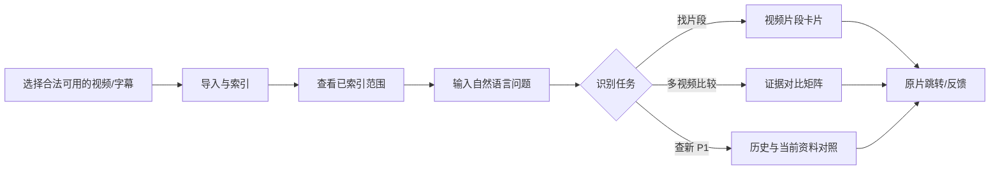
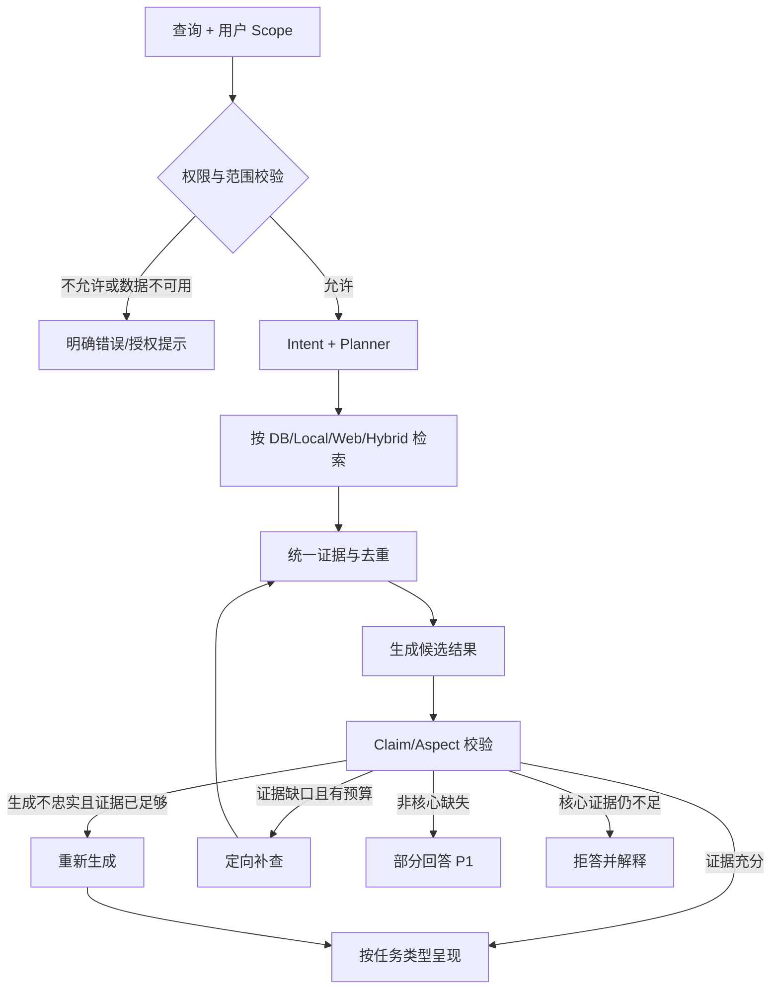

# BiliMind｜产品需求文档（PRD）

> **版本 V1.1｜面向技术学习者的视频知识找回与跨视频证据问答**

| 文档属性 | 内容 |
|---|---|
| 文档类型 | MVP 产品需求文档（Product Requirements Document） |
| 更新日期 | 2026-11-12 |
| 项目阶段 | 产品化设计 / 待研发验收；非已发布产品说明 |
| 需求来源 | [《BiliMind 产品分析报告》](./BiliMind_产品分析.md) |
| 技术基础 | 用户提供的《Bilibili-RAG》README 所述能力；尚未核验仓库代码 |
| 目标对象 | 产品、设计、前端、后端、AI 工程及测试人员 |

**状态约定：** `原项目自述`＝原技术 README 中声称已有的实现，不代表已验收；`P0/P1/P2`＝拟实现优先级；`待验证`＝依赖用户研究或实验确认。此 PRD 中的新页面、字段、算法策略和事件定义，均为**规划需求**，不能在对外介绍时直接表述为已上线。

---

## 1. 需求概述与版本目标

### 1.1 版本目标

在用户拥有可合法处理的视频或字幕资料时，提供两条能够端到端完成的用户任务：

1. **找回视频知识片段**：用户用自然语言描述概念，找到对应视频、分 P 和时间位置；
2. **跨视频观点对比**：用户比较收藏视频中同一问题的不同说法，能够检查每项关键观点的原始来源。

P1 增强任务：在用户允许联网时，对比旧教程与当前资料，明确区分历史内容、当前内容和不确定项。

### 1.2 MVP 业务验收目标

- 新用户能够通过受支持、已授权的方式导入指定视频/字幕，并知道**哪些内容已成功索引、哪些未覆盖**；
- 针对已建立索引的视频，能够完成自然语言查找及原片跳转；
- 跨视频结果明确区分**视频原始证据、模型归纳和未知信息**；
- 用户选择“仅本地”时，**不得触发任何外部 Web 检索**；
- 在没有充分证据时，不将猜测包装成确定事实；
- 每次查询能够记录可复查的 Agent Trace 和用户反馈。

**不以固定用户增长率或准确率数字作为此文的既有事实。** 具体上线阈值需在建立 Baseline 后确认，见第 8 节。

### 1.3 范围定义

| 优先级 | 范围 | 说明 |
|---|---|---|
| P0 | 导入/索引状态；按范围检索；片段卡片与时间戳；跨视频证据对比；来源模式；可靠性反馈；运行日志 | MVP 必需闭环 |
| P1 | 旧教程与最新资料比较；部分回答细化；历史结果/引用导出 | 验证后扩展 |
| P2 | 多模态代码画面理解；自动学习画像；知识图谱；主动课程规划 | 本版本不开发 |

### 1.4 非目标

不要求抓取所有 B 站视频、不假定存在无限制收藏夹接口、不自动代用户操作账号、不默认保存全部聊天记录、不把视频收藏当成已掌握知识、不对所有回答提供绝对正确性承诺。

---

## 2. 用户角色、入口与信息架构

### 2.1 用户角色

**学习用户：** 导入自己具有处理权限的学习内容；限定检索范围；发起查找/比较；查看依据并反馈。

**项目维护者（开发/测试）：** 只在受控环境查看脱敏 Trace、评测结果、索引错误和 Badcase；正式使用时不应默认访问用户的原始私人收藏内容。

### 2.2 信息架构（IA）

```text
BiliMind
├─ 我的知识库
│  ├─ 已导入的收藏夹 / 视频
│  ├─ 索引进度与覆盖率
│  ├─ 未索引/失败记录与重试
│  └─ 删除索引
├─ 智能检索（主入口）
│  ├─ 问题输入 + 来源模式 + 视频范围
│  ├─ 视频片段结果
│  ├─ 跨视频观点对比
│  └─（P1）历史 vs 当前资料
├─ 历史结果（P1）
└─ 设置
   ├─ 外部模型/联网说明与开关
   ├─ 数据权限、删除与退出
   └─ 反馈/问题报告
```

**首屏建议：** 新用户先展示“导入 10–20 个技术视频试用”；已建库用户默认进入“智能检索”。不把 Agent 节点图作为普通用户主界面。

### 2.3 主要用户旅程



---

## 3. 功能清单与依赖

| ID | 需求名 | 优先级 | 主要依赖 | 状态 |
|---|---|---|---|---|
| F01 | 合规导入与索引作业 | P0 | 视频/字幕来源、ASR、索引服务 | 部分底层能力为原项目自述；产品流程待实现/验收 |
| F02 | 知识库概览与覆盖状态 | P0 | IndexJob、视频元数据 | 规划 |
| F03 | 自然语言片段找回 | P0 | SQLite、ChromaDB、时间戳 | 原项目自述有检索与追溯；UI 待实现/验收 |
| F04 | 跨视频证据对比 | P0 | 多视频检索、Evidence Fusion | 底层为原项目自述；结构化展示待实现 |
| F05 | 来源范围与检索模式 | P0 | Planner、权限约束 | Planner 为原项目自述；产品约束待补充 |
| F06 | 证据展示、错误与拒答 | P0 | Verifier、来源引用、错误状态 | 底层校验为原项目自述；前台状态待补充 |
| F07 | 反馈与 Badcase Trace | P0 | 事件采集、可观测系统 | 规划 |
| F08 | 历史/当前资料对照 | P1 | Local + Web + 时间数据 | Hybrid 为原项目自述；专用页面待补充 |
| F09 | 部分回答与定向补查 | P1 | Aspect 检查、Retriever | 产品策略规划 |
| F10 | 历史任务与导出 | P1 | 历史存储、引用导出 | 规划 |

---

## 4. P0 功能需求与验收标准

### F01｜视频/字幕导入与索引

**用户故事：** 作为技术学习者，我希望选择自己有权处理的视频或字幕并建立索引，而不必首次就批量处理整个账号。

**输入：** 用户选择的视频链接/可用字幕；如果实际开放接口支持且已获授权，可提供收藏夹选择。不得假定收藏夹授权 API 必然可用。

**系统处理：** 检查来源和可处理性 → 优先采用可合法获取的字幕或执行获准的 ASR → 分 P / 时间切片 → Embedding / 入库 → 写入索引状态。

**输出：** 视频清单、索引作业状态、成功/失败原因、更新时间。

**验收（AC）：**

- AC-01：用户能够选择具体内容，而不是被迫全量导入；
- AC-02：处理中的视频显示明确状态，完成后可用于检索；
- AC-03：对无字幕、链接失效、不支持或权限不足，给出不同错误提示；
- AC-04：重试失败作业时不产生重复视频实体或重复索引污染；
- AC-05：用户要求删除后，系统删除相应持久化索引与关联数据（遵守数据保留约定）；
- AC-06：不得要求用户以明文方式提交敏感登录 Cookie 才能体验基本流程。

### F02｜知识库状态与覆盖提示

**页面组件：** 总视频数、已索引数、处理中、失败、不支持、按收藏夹/视频筛选、重试入口、最后同步时间。

**核心规则：** “未找到答案”与“有关视频尚未索引”必须区分；已索引比例的分母及是否包括无权限来源要在产品口径中明确。

**验收：**

- AC-01：任一视频都能够查看当前处理状态及最近一次失败原因；
- AC-02：部分索引时，检索页显示“仅检索已索引内容”的范围提示；
- AC-03：索引错误可以单项重试，不需重新处理所有成功内容；
- AC-04：不存在将失败视频标记为“内容不存在”的误导性提示。

### F03｜自然语言找回视频片段

**示例 Query：** “我收藏过哪个视频讲过 KV Cache 为什么缓存 K、V？”

**输入：** 问题、选定收藏夹/视频、来源模式、最近会话上下文（如用户允许）。

**处理策略：** 意图为“找视频/片段”时优先检索并返回相关片段，不默认生成长篇答案；可以结合元数据过滤、关键词检索、向量召回和排序。

**输出组件：** 视频标题/UP 主、命中片段高亮、匹配原因的简要解释、分 P、时间戳、原片跳转、查看更多。

**验收：**

- AC-01：结果含可识别视频 ID 和可访问的时间位置；
- AC-02：点击原片能在支持的情况下定位相应分 P 与时间戳；
- AC-03：检索范围正确，不返回用户明确排除的视频；
- AC-04：若视频不可播放、已下架或时间戳不可用，明确告知并保留可用的来源信息；
- AC-05：无匹配证据时展示“未从当前已索引内容中找到”，不推断整个 B 站不存在相关内容。

### F04｜跨视频观点对比（MVP 核心展示场景）

**示例 Query：** “比较我收藏的三条 RAG Chunking 教程：各自推荐什么、适合什么场景、有什么局限？”

**输入：** 用户问题、收藏范围、可选指定视频集合。

**处理策略：** 拆分比较维度 → 检索多个视频的证据 → 来源标注与去重 → 保留关键差异与矛盾 → 仅在有支持证据时汇总结论。

**输出结构：**

| 维度 | 视频 A | 视频 B | 视频 C |
|---|---|---|---|
| 主要观点 | 内容 + 证据片段 | 内容 + 证据片段 | 内容 + 证据片段 |
| 适用场景 | 有依据则显示 | 有依据则显示 | 有依据则显示 |
| 局限/风险 | 无依据标注“未找到” | 同左 | 同左 |

表格下方显示“共同点 / 分歧 / 尚未获得证据的信息”，每项关键结论可展开到原片时间戳。

**验收：**

- AC-01：每条被归于某个视频的实质观点都可回溯到该视频的 Evidence；
- AC-02：对于视频没有提到的维度，显示“当前证据未覆盖”，不得编造该视频观点；
- AC-03：不同视频结论冲突时，允许并列展示，不默认合成单一说法；
- AC-04：用户可独立跳转任一来源并继续追问；
- AC-05：跨视频至少有 2 个实际命中来源才能称为多视频对比；否则提示覆盖不足。

### F05｜知识来源模式与范围约束

**控制项：**

- 自动（默认）：系统在允许的来源集合内按任务选择；
- 仅本地：只用已授权、已索引的视频/字幕；**严格禁止 Web**；
- 仅联网：只用外部资料（用户明确同意）；
- 双来源：同时允许本地与 Web，适合历史/当前比较；
- 范围过滤：指定收藏夹、视频集合；未指定则使用用户明确授权的默认范围。

**策略优先级：** `数据合规与访问授权 > 用户显式来源/范围选择 > 用户任务意图 > Planner 自动建议 > 成本与延迟优化`。任何 Agent 的反馈动作都不得覆盖更高优先级约束。

**术语澄清：** “仅本地”只表示**知识来源限于本地视频库**，不代表大模型必然在本地运行。如需要将视频片段发送到第三方 LLM API，界面必须单独告知并遵守用户的隐私/授权设置；不能把“仅本地来源”包装为“完全离线”。

**验收：**

- AC-01：“仅本地”模式下，即使 Verifier 请求补充资料，也不得触发 Web 工具调用；
- AC-02：切换范围时，下一个查询使用新范围；显示当前所用来源；
- AC-03：若用户只允许本地而问题要求“最新版本”，告知无法确认当前状态，并提供选择性联网入口；
- AC-04：未经用户允许不得自动跨越到另一个收藏夹或公开外部来源。

### F06｜证据引用、结果可信度与失败反馈

**用户看到的，不是内部 LLM 分数，而是明确可核查的结果状态：**

| 状态 | 用户文案含义 | 行为 |
|---|---|---|
| 已找到证据 | 关键结论均有可追溯的对应来源 | 显示答案与引用 |
| 部分证据 | 某些维度有证据、其余未知 | 保留已知内容，标注缺口；完整体验 P1 增强 |
| 来源有分歧 | 不同视频/文档存在不一致 | 并列说明，不擅自定论 |
| 未找到证据 | 在当前可检索内容内未找到足够信息 | 缩小/修改问题，检查索引覆盖 |
| 索引不完整 | 部分视频尚未处理 | 给出未覆盖范围和重试入口 |
| 工具失败 | 查询因服务、网络或 ASR 处理问题中断 | 显示重试、错误说明；不得伪称没有知识 |
| 无法可靠回答 | 不可缺少的核心结论无法获得支撑 | 明确拒答并解释边界 |

**验收：**

- AC-01：点击引用时能看见原始证据或准确知道为什么无法访问；
- AC-02：不能把 `support_score=0.85` 显示为“85% 真实准确率”；
- AC-03：有关键无证据结论时不得直接输出确定性结论；
- AC-04：工具失败和没有检索到证据必须使用不同状态；
- AC-05：引用外部 Web 时显示来源 URL、资料时间（有则显示）、检索时间。

### F07｜用户反馈与 Trace

**交互：** 结果底部提供“有用 / 无用 / 引用有误 / 没回答问题 / 内容已过时”；在用户愿意时可填写补充描述。

**记录字段建议：** `query_id/trace_id`、时间、匿名或授权用户标识、任务类型、来源范围、route、模型/提示版本、检索证据 ID、Verifier action、耗时与 Token/工具成本、反馈类型。原文日志的存储需遵守用户数据处理约定。

**验收：**

- AC-01：任何反馈能关联到一个可复查的请求 Trace；
- AC-02：反馈可按“索引/路由/检索/生成/验证/交互”分类；
- AC-03：错误处理不吞掉失败原因和重试次数；
- AC-04：日志默认不公开泄露用户收藏夹、字幕全文或身份信息。

---

## 5. P1 增强需求

### F08｜历史教程与当前资料对比

**用户故事：** 我在看旧版 LangChain 教程，希望了解它与当前官方 API 的差异，而不是把两个时期的内容混在一起。

**输出模板：** `视频当时的实现（来源+时间） → 当前资料（来源+时间） → 变化与影响 → 未确认项`。

**验收：** 用户禁止联网时不能生成“当前官方状态”式结论；如果外部资料无有效时间或缺乏可支撑依据，应标注不确定；视频原话和 Web 归纳不能混同。

### F09｜部分回答与定向补查

**用户故事：** 当三项子问题只查到其中两项时，我希望先看到可靠部分，同时知道剩余什么还未找到。

**策略：** 非核心缺口优先保留可核实部分；仅对缺失 Aspect 定向重检；必要时由用户选择是否扩展来源；核心问题无法回答则明确拒答。

**验收：** 不出现“已找到 2/3 个方面却整体返回空白”；但涉及不可省略的核心断言时，不能用局部证据制造完整结论。

### F10｜历史任务、笔记与引用导出

**用户故事：** 我希望后续找回曾整理过的多个视频观点，不必重新生成；复制笔记时不会丢掉证据来源。

**验收：** 导出内容包含来源标题、可访问链接和时间戳；用户能删除自己保存的历史；当原片失效时保留失效标识而非假装引用仍然有效。

---

## 6. Agent/RAG 行为契约

### 6.1 现有技术基础与新增约束

[原项目自述] Retrieval Planner 在 `direct / db / local_vector / web / hybrid` 等路径中选择，使用 Evidence Fusion、Answer Generator、Evidence Verifier 和最多一次重检；Verifier 进行 Claim Support、Query Coverage、Source Consistency 及 Evidence Sufficiency 检查。该架构中的“已存在”仅限 README 自述，不等于当前 PRD 已完成验收。

**本 PRD 新增的产品约束：** 必须尊重用户来源范围、权限、检索覆盖度、输出形式、超时预算和失败状态；“去哪个检索器”与“用户看见什么”分开决策。

### 6.2 三层决策模型

| 层级 | 决策项 | 示例 |
|---|---|---|
| Task Intent | 用户要执行什么任务 | 找视频、问概念、比较、查新、统计 |
| Knowledge Source | 哪类来源能够支撑任务 | DB、Local、Web、Hybrid、Direct |
| Presentation | 哪种结果更适合完成任务 | 视频卡片、简明解释、对比矩阵、时间差异报告、部分回答 |

**规则：** 对“列出某收藏夹视频数量”这类结构化任务，优先 DB；对“在哪个视频听到过某概念”，优先 Local + 卡片；对“现在 API 变了吗”，若权限允许，选择 Hybrid 或 Web，结果按时间分栏。

### 6.3 Planner 的输入与输出（建议数据契约）

```json
{
  "query": "视频里讲的 Agent API 现在有什么变化？",
  "scope": {
    "folder_ids": ["folder_demo"],
    "video_ids": [],
    "source_mode": "auto",
    "web_allowed": true
  },
  "knowledge_stats": {"indexed_videos": 18, "total_videos": 20},
  "context": {"last_selected_video": "BV_DEMO"}
}
```

```json
{
  "intent": "freshness_comparison",
  "route": "hybrid",
  "local_query": "视频中介绍的 Agent API 是什么",
  "web_query": "current official Agent API migration guidance",
  "presentation": "version_diff",
  "reason_code": "needs_historical_and_current_evidence"
}
```

以上为**接口示例**，不是系统已实际返回的 API 响应。实际生产实现需要校验枚举值、长度、空值与用户权限。

### 6.4 统一证据模型（建议）

```json
{
  "evidence_id": "L1",
  "source_type": "video",
  "source_id": "BV_DEMO",
  "part_id": "P1",
  "title": "示例教程",
  "start_ms": 752000,
  "end_ms": 795000,
  "snippet": "示例转写片段",
  "retrieval_score": 0.82,
  "retrieved_at": "2026-11-12T10:00:00+08:00"
}
```

Web Evidence 应单独包含 `url`、`published_at/updated_at`（可得时）、`retrieved_at` 和来源类型；不可用的字段明确置空，不编造日期。`retrieval_score` 表示召回相关性信号，不代表事实支持概率。

### 6.5 Verifier 决策与异常处理表

| 检查结果 | 系统动作 | 产品侧表现 |
|---|---|---|
| 证据完整，关键 Claim 全部支持 | `pass` | 展示结果和证据 |
| 证据本身充足，但生成引用错误/过度推断 | `regenerate`（规划扩展） | 修正表达；原则上不必额外 Web |
| 某 Aspect 缺少本地证据 | `local_reretrieve`（预算允许） | 补查该缺口 |
| 明确要求最新资料，且允许联网 | `web_search` / `hybrid_reretrieve` | 补充带时间的外部来源 |
| 用户明确设置仅本地 | 禁止任何 `web_search` | 提示“无法核对当前资料” |
| 来源冲突但能解释版本差异 | `pass_with_conflict`（规划） | 并列原说法与当前说法 |
| 仅非核心维度缺失 | `partial`（P1） | 显示已知与未知 |
| 核心结论无可靠依据、补查失败 | `abstain` | 告知无法可靠回答 |
| 外部搜索工具失败 | `tool_error` | 重试提示，非“没有答案” |

**预算边界：** 原方案 `max_retry = 1` 可以作为初始默认；具体是否对所有任务统一生效需实验决定。不得允许循环无界运行；每个节点须有超时与失败返回路径。

**输出风险：** `support_score` 和 `coverage_score` 是规则聚合的判定分数，不是校准后的正确率。原 README 的 0.8 是工程经验阈值，是否保留应在人工标注集上验证。

### 6.6 典型任务状态机



`regenerate / partial / pass_with_conflict` 是推荐扩展，不应误写为原项目已有的状态枚举；具体实现可将它们映射到已有 Workflow 的动作和结果状态。

### 6.7 多轮与用户纠偏

- 用户说“只看刚才那条视频”时，缩小 Scope 并重新检索，不沿用上一轮其他视频的证据；
- 用户说“不要联网”时，当轮立即生效；若之前结果含 Web，要明确当前问答重新使用仅本地来源；
- 用户纠正某条视频片段时，记录引用错误反馈，不能把用户纠正内容自动当作所有会话中的权威数据；
- 对话上下文只用于理解指代和用户明确选择的范围，不等同于永久记忆或知识本体。

---

## 7. 数据、异常与非功能要求

### 7.1 主要数据对象

| 对象 | 建议字段 | 设计要点 |
|---|---|---|
| Video | `bvid, title, author, published_at, duration` | 视频身份与发布信息 |
| UserVideoRelation | `user_id, folder_id, bvid, saved_at` | 收藏关系与视频实体分开；同视频允许多收藏夹引用 |
| Part | `bvid, cid, part_id, duration` | 支持多 P 定位 |
| TranscriptSegment | `segment_id, bvid, part_id, start_ms, end_ms, text, origin, version` | ASR/字幕来源与时间范围 |
| IndexJob | `job_id, video_id, status, error_code, created_at, finished_at` | 显式状态，不以静默失败收尾 |
| Evidence | `evidence_id, source_type, source_id, snippet, citation_target, retrieved_at` | 多来源统一引用与可访问性 |
| QueryTrace | `query_id, scope, route, evidence_ids, verifier_action, latency_ms, cost` | 评测、排错与反馈追踪 |
| Feedback | `query_id, issue_type, useful, note` | Badcase 复盘；用户隐私最小化 |

### 7.2 索引状态枚举（建议）

`pending / processing / indexed / failed / unsupported / deleted`。

- `failed`：本可处理但因网络、ASR、索引等原因失败，可重试；
- `unsupported`：当前无法合法获得或技术上不支持，不能伪称“处理失败可无限重试”；
- `deleted`：用户删除的索引不可继续用于检索；
- 已有索引因源数据变化而过期时，记录版本和更新时间，避免旧片段长期误导用户。

### 7.3 非功能和风控约束

1. **权限与版权：** 遵循平台协议及内容权利边界；正式使用前核查实际数据获取方式，禁止以未授权抓取作为 MVP 的隐含依赖。
2. **用户隐私：** 明确告知可能发送给外部模型和 Web 服务的数据类型；默认最小化日志内容；提供删除路径。
3. **来源完整性：** 引用必须包含可定位标识；来源失效时显示“暂不可访问”，不编造新链接。
4. **ASR 盲区：** 仅转写语音可能遗漏屏幕代码、图表和参数；这类问题优先指向原片而非猜测。
5. **安全边界：** 来自视频字幕或 Web 的文字是检索资料，不能被当成系统指令执行；工具调用遵守显式来源白名单与权限。
6. **运行稳定性：** 重试、超时、取消、重复请求均要有确定返回状态；性能目标在测得基线后设置。

---

## 8. 指标、埋点与评测验收

### 8.1 产品核心指标口径

| 指标 | 推荐公式/口径 | 注意事项 |
|---|---|---|
| 任务完成率 | 独立任务标准判定成功的任务数 ÷ 有效任务数 | 预先固定成功标准；任务超时计入未完成 |
| 成功任务耗时 | 从任务开始到满足成功标准的时间 | 同时单列失败任务，避免幸存者偏差 |
| 有用率 | 反馈“有用”的有效评价数 ÷ 有效评价数 | 存在选择性反馈偏差 |
| 索引成功率 | 完成索引的视频数 ÷ 有权限且已发起处理的视频数 | 无权处理的视频应单列 |
| 索引覆盖率 | 已索引视频数 ÷ 当前选择范围内的目标视频数 | 可用/不可用来源需拆分显示 |
| 片段定位正确率 | 命中人工标注时间窗口的结果数 ÷ 被核验结果数 | 先定义容差，例如 ±15 秒为实验起点 |
| 引用可访问率 | 可打开并到达有效证据位置的引用数 ÷ 被检查引用数 | 需考虑视频下架或限制访问 |
| Recall@5 | Top5 中至少包含一个金标相关片段的查询数 ÷ 有相关片段的查询数 | 证据缺失问题另算 |
| Planner 路由合规率 | 选择属于金标允许路径集合的查询数 ÷ 被审核查询数 | 多条路径可能都合理 |
| Claim 支持率 | 人工判定获证据支持的关键 Claim 数 ÷ 全部被审核关键 Claim 数 | 与模型自身 support_score 区分 |
| Verifier 错误放行率 | 人工不可通过但判 Pass 的样本数 ÷ 人工不可通过样本数 | 核心安全指标 |
| Verifier 错误拒答率 | 人工可通过但判拒答的样本数 ÷ 人工可通过样本数 | 过严也会伤害可用性 |
| Web 调用率 | 发起 Web 请求的任务数 ÷ 有效任务数 | 仅降低调用率不代表产品改善 |
| P95 任务延迟 | 95% 样本不超过的端到端耗时 | 按 DB/Local/Hybrid 和冷/热启动分别统计 |

**北极星候选：** 每周有效知识复用任务数；早期测试时以**标准任务完成率与耗时**为主要衡量，不追求没有意义的 DAU。

### 8.2 事件埋点（建议）

| 事件名 | 触发时机 | 重要属性 |
|---|---|---|
| `import_started` | 开始导入 | scope、source_type、job_count |
| `index_job_finished` | 单项索引完成/失败 | status、error_code、duration |
| `query_submitted` | 提交问题 | task_intent(后补)、scope、source_mode |
| `retrieval_finished` | 完成某次检索 | route、num_evidence、latency |
| `verification_finished` | Verifier 给出结果 | action、critical_issue、retry_count |
| `answer_rendered` | 结果可见 | result_type、citation_count、latency |
| `citation_opened` | 打开引用 | citation_type、timecode_valid |
| `feedback_submitted` | 提交反馈 | issue_type、query_id |
| `task_success_confirmed` | 用户/观察者确认任务完成 | task_id、time_elapsed |

所有事件应有 `trace_id` 以便关联；实际数据采集须遵守隐私告知和用户许可要求。

### 8.3 离线 Golden Dataset（[规划] 120 条）

| 场景 | 建议数量 | 关键金标 |
|---|---:|---|
| 结构化元数据与索引状态 | 20 | 期望 DB 查询结果、覆盖范围 |
| 单视频知识定位 | 25 | 正确视频/分 P/片段时间窗口 |
| 跨视频观点比较 | 25 | 多个相关片段、共识/分歧与必答维度 |
| 旧教程/当前资料比较 | 20 | 历史内容、当前一手资料、时间信息 |
| 证据缺失/拒答 | 15 | 缺失的关键 Claim/Aspect、预期行为 |
| 多轮/复杂与异常任务 | 15 | Scope 变更、工具失败、恢复动作 |
| **合计** | **120** | |

至少将数据区分为开发集与冻结测试集（示例：80/40）。关键证据与预期结论人工复核；跨视频样本可采用双人标注，记录不一致意见。生成测试数据不能代替真实金标。

### 8.4 Baseline 与对照实验

| 实验 | 基线 A | 变体 B | 主要考察 |
|---|---|---|---|
| E1 检索策略 | Dense-only | Dense + BM25 + Rerank | Recall@5、定位、延迟 |
| E2 检索规划 | 固定路由/简单规则 | Adaptive Planner | 路由合规、任务完成、成本 |
| E3 校验机制 | Single-pass RAG | Generator + Verifier | 无依据结论、误放行/误拒答、延迟 |
| E4 联网策略 | Always-Web | On-demand Web | 正确性、冗余信息、Web 调用率 |
| E5 产品输出 | 纯文本答案 | 卡片/对比表格/差异报告 | 任务完成率、耗时、可理解性 |

**实验约束：** 固定模型和数据快照；同一次对照只改变一项核心策略；同时报告分场景效果、错误案例、延迟和成本。不要仅用内部 `support_score` 衡量自身架构的改进。

### 8.5 实际用户任务测试

建议 10–20 位目标用户参与，按相近难度任务对照“用户原有检索方式”和 BiliMind：

- T1：依据概念描述找回准确视频片段；
- T2：比较 2–3 个视频中同一方法的适用条件和局限；
- T3（P1）：辨别旧教程与当前官方资料的差异。

对照任务顺序要平衡；获得同意后记录点击、耗时和口头反馈；任务成功标准在开始测试前写定，不能测试后改口径。样本小的情况下给出实际 `n`、失败任务和测试条件，不对全体用户作过度推断。

---

## 9. Badcase 流程与验收用例

### 9.1 Badcase 归因层

`Ingestion / Indexing / Routing / Retrieval / Grounding / Verification / Interaction / Tool Error`。

每条真实问题需要记录：`case_id → 用户目标 → 期望结果 → 实际结果 → 关键 Trace → 可证据化根因 → 修改假设 → 回归集 → 前后指标 → 副作用 → 保留/回滚决策`。

**示例（非真实运行结果）：** 用户问“视频画面中 chunk_size 的值是多少”，ASR 只有“这里改成这个值”。若 AI 猜测具体数值，根因更可能是画面事实未进入知识库，而不是生成 Prompt 不够长。MVP 应标注不能确认并提供原片时间戳；多模态能力是否值得做由此类问题的实际频率决定。

### 9.2 UAT 核心验收清单

| 用例 | 操作 | 预期结果 |
|---|---|---|
| UAT-01 | 导入 10 条支持的合法视频/字幕 | 状态变化可见，成功项可查 |
| UAT-02 | 导入无权限/失效来源 | 明确 unsupported/失败原因，不静默跳过 |
| UAT-03 | 选择仅某收藏夹，问具体概念 | 不跨范围返回证据 |
| UAT-04 | 问“哪个视频讲过 KV Cache” | 优先返回片段卡片与跳转，不强制长答案 |
| UAT-05 | 对比 3 个不同视频的技术观点 | 每个主要观点有对应证据；未知不编造 |
| UAT-06 | 在“仅本地”询问最新 API | 不访问 Web；明确无法核对实时资料 |
| UAT-07 | 两来源存在真实版本冲突 | 明确分列来源、时间和差异 |
| UAT-08 | 只有部分视频完成索引 | 显示覆盖不足，不声称收藏夹完全无结果 |
| UAT-09 | 检索/外部工具失败 | 显示工具故障及重试路径，不伪称没有知识 |
| UAT-10 | 反馈“引用错误” | 能追溯到 query_id、Evidence 和错误类别 |
| UAT-11 | 删除已建立索引的视频 | 后续检索不再引用已删除数据 |
| UAT-12 | Verifier 发现关键断言无证据 | 不放行确定性结论；保留可理解的失败说明 |

**验收原则：** 对功能性/权限性硬约束（例如仅本地不得联网）采用严格通过要求；对召回、耗时、误拒答等统计性能指标，先有可重复 Baseline 再确定合格阈值。

---

## 10. 开发顺序、依赖与交付物

| 阶段 | 核心工作 | 交付结果 |
|---|---|---|
| M0：产品研究 | 访谈与用户任务观察；核查导入方式可行性 | 假设验证表、数据权限边界 |
| M1：P0 体验闭环 | 导入与覆盖状态、片段卡片、跨视频对比页、模式控制 | 可被目标用户独立使用的 MVP |
| M2：质量可测 | Trace、反馈、120 条目标测试集、Baseline | 可复现实验与 Badcase 仪表盘 |
| M3：产品迭代 | 按失败类型优化检索/Verifier/交互 | 真实 before/after 报告 |
| M4：P1 扩展 | 查新报告、部分回答、引用导出 | 经验证有增益才进入下一版 |

**关键依赖（Go/No-Go）：**

1. 能否稳定、合法取得足够的视频文本材料？若不能，缩小为用户主动导入字幕；
2. 目标用户是否真的需要反复找回/比较收藏知识？若不是，改变入口，而非强行加功能；
3. 每个关键 Agent 节点是否相对 Baseline 改善任务结果？若否，删减复杂度；
4. 是否出现“自信但无证据”的高风险错误？若有，优先修复可靠性，不先增长功能数量。

---

## 11. 尚待确认的产品决策

| 问题 | 当前处理 | 决策依据 |
|---|---|---|
| 第一版支持直接同步收藏夹吗？ | 不预设；取决于实际授权接口 | 权限核查与可用性验证 |
| 是否默认所有查询都走 Verifier？ | 不预设；简单 DB / 找视频可走轻量路径 | 延迟、成本与质量实验 |
| Partial Answer 是否作为 P0？ | 先实现不编造/可解释拒答；P1 优化局部输出 | 评测与可用性反馈 |
| RAG 是否需要全量多模态？ | 暂不需要 | 画面信息缺失 badcase 占比 |
| 是否保留 Web Search Agent 单独节点？ | 先保留原方案，比较简单规则与独立节点 | 对照实验 |
| 是否需要用户长期记忆？ | 暂不做 | 真实跨会话重复需求 |

---

## 附录：与现有项目材料的关系

**原始技术资料：** 旧\README.md，其中已有架构描述：视频获取/ASR/索引、SQLite + ChromaDB、Planner 多路检索、Evidence Fusion、Answer Generator、Verifier、Rewrite、最多一次 Retry、Abstain。

**本文件新增内容：** 用户工作流、页面结构、功能需求与验收、来源权限规则、异常状态、产品级结果样式、埋点口径、Golden Dataset 及实验计划等。它们属于拟开发/拟验证需求，不能直接视为原项目已有实现。

**进一步阅读：** [《BiliMind 产品分析报告》](./BiliMind_产品分析.md) 给出产品定位、用户研究、竞品、差异化、优先级与商业/技术风险的判断。本 PRD 不重复这些论证，专注回答**“具体做什么、怎样运行、如何验收”**。
