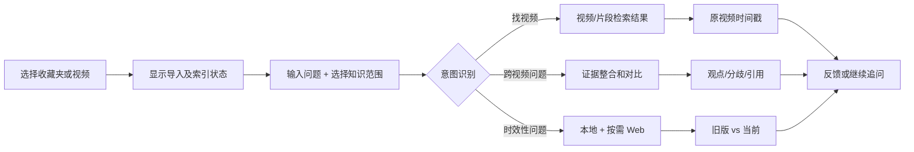
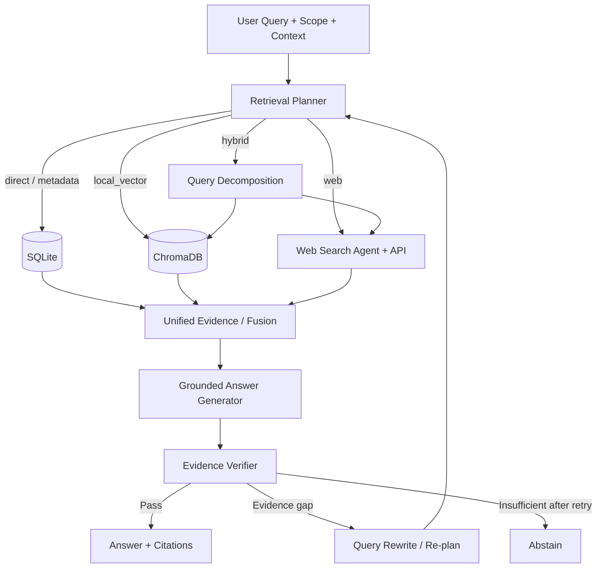

# BiliMind

> **让收藏的视频变成可以再次使用的知识。**  
> 面向技术学习者的 B 站个人视频知识助手：收藏内容检索、跨视频观点整合、技术知识时效性对比与证据溯源。

**项目技术定位：** Evidence-Grounded Adaptive Agentic RAG for Video Knowledge Bases  
**原项目名称：** Bilibili-RAG  
**目标用户：** 通过 B 站学习计算机、AI、编程等知识的学生与初级开发者  
**文档版本：** 产品化方案 v1.0 · 2026-11-12

> **状态说明（请在公开发布前确认）**  
> 本文基于原始《Bilibili-RAG》README 重构，**原 README 声明已覆盖**的能力以 `原有方案` 标记；新增交互、业务功能、数据规范、评测和优化方向以 `规划 / 待验证` 标记。未审查真实代码、部署环境或用户研究结果，**不能将此文视为已完成实现的验收报告**。发布前建议结合仓库实际情况逐项更新。

---

## 1. 为什么做 BiliMind？

收藏知识不等于能够复用知识。技术学习者在 B 站收藏了大量教程之后，往往遇到三类待验证问题：

1. **找不到：** 记得学过 KV Cache、RAG Chunking，但忘了收藏在哪个视频、哪个时间点。
2. **串不起来：** 不同 UP 主对同一技术的解释各有侧重，逐个回看成本高。
3. **不知道是否过时：** 收藏的视频讲解的是旧版框架或旧 benchmark，难以判断今天是否仍然适用。

BiliMind 的产品假设不是“用户缺少 AI 视频总结”，而是：**用户需要把分散的历史视频内容变成可找回、可对比、可追溯、可更新的个人知识资产。** 以上问题仍须通过访谈和任务测试验证。

### 核心价值

| 用户任务 | 期望产物 | 产品价值 |
|---|---|---|
| 找回收藏知识 | 视频卡片、相关片段、时间戳 | 减少重复搜索与回看 |
| 比较多个教程 | 多来源观点对比、共识/分歧、原片引用 | 快速整合知识 |
| 检查技术时效性 | 视频历史说法 vs 当前来源、差异说明 | 降低旧知识误用风险 |

**不做的事（当前阶段）：** 不做全平台通用视频总结器、不推断用户已掌握知识、不承诺所有视频均可完整理解、不追求 Agent 数量、不提供无证据的权威结论。

## 2. 目标用户与关键场景

**P0 用户：** 有一定技术收藏量、经常需要回顾技术概念或代码教程的计算机/AI 学习者。  
**P1 用户：** 有课程知识整理需求的考研、考证或其他系统学习者。

### 场景 A · 找回知识（P0）

> “我之前收藏过解释 KV Cache 为什么缓存 K、V 的视频，帮我找出来。”

**推荐输出：** 相关视频列表 → 最相关的字幕/转写片段 → `BV 号 / 分 P / 时间戳` → 点击回到原视频。  
**产品原则：** 用户在找视频时，优先返回 **可操作的检索结果**，而非冗长的生成式回答。

### 场景 B · 跨视频知识整合（P0，主场景）

> “对比我收藏夹中几个讲 RAG Chunking 的视频：各自推荐什么方法？适用场景和局限是什么？”

**推荐输出：** 对比表格 → 每条观点对应的视频与时间戳 → 共识/分歧/缺失信息 → 继续追问。  
**产品原则：** 不把多个来源硬融合成单一结论；“视频说过”和“模型归纳”在结果中可区分。

### 场景 C · 技术内容时效性校验（P1）

> “我收藏的旧版 LangChain Agent 教程，现在 API 有什么变化？”

**推荐输出：** 当时视频中的实现 → 当前官方资料中的描述 → 变化与潜在影响 → 分别引用本地视频和 Web 来源，显示时间信息。  
**产品原则：** Local-first、按需联网，保持历史语境与当前知识边界。

## 3. 功能地图与实现状态

> 状态划分参照原 README 的自述，不代表已对代码进行验收。

| 模块 | 功能 | 优先级 | 状态 |
|---|---|---|---|
| 内容摄取 | B 站收藏夹/视频同步、视频获取、ASR、切块与索引 | P0 | 原 README 声明已覆盖 |
| 个人知识库 | ChromaDB 语义索引、SQLite 结构化元数据 | P0 | 原 README 声明已覆盖 |
| 自适应检索 | Planner 规划 DB / Local / Web / Hybrid 等路由 | P0 | 原 README 声明已覆盖 |
| 证据问答 | Evidence Fusion、引用、Verifier、有限 Retry、Abstain | P0 | 原 README 声明已覆盖 |
| 可视化结果 | 视频卡片、时间戳直达、跨视频比较视图 | P0 | 产品交互待补充/验收 |
| 导入体验 | 选择性导入、进度、失败原因、重试、索引覆盖率 | P0 | 规划 |
| 用户控制 | 收藏夹/视频范围、仅本地/智能/联网模式 | P0 | 规划 |
| 反馈闭环 | 答案有用/无用、引用错误、badcase 标记 | P0 | 规划 |
| 部分回答 | 有证据的部分先回答，缺失部分明确标注 | P1 | 规划 |
| 技术过时提醒 | 视频历史知识与当前文档的时间差异显示 | P1 | 规划 |
| 多模态补充 | 对授权视频进行关键帧/代码画面理解 | P2 | 研究方向，不在 MVP 中承诺 |

## 4. 用户使用流程（目标体验）



**关键交互规则：**

- **范围可控：** 默认智能选择知识源；用户明确选择“仅本地”时不得擅自联网。
- **检索过程可理解：** 告知“正在检索收藏内容 / 比较外部资料”，不展示不必要的内部推理文本。
- **结果形式随任务变化：** 找视频给卡片，比较给矩阵，时效性问题给差异报告。
- **优先可追溯：** 视频观点引用具体片段和时间戳；Web 观点注明来源与访问时间。
- **允许不确定：** 只找到部分证据时不补造缺失信息；可提供部分回答、补查建议或拒答。
- **导入可见：** 知识库应显示“已索引 / 待处理 / 失败 / 无可用字幕”等状态，避免把未索引误认为没有知识。

## 5. Agentic RAG 架构（原有方案）



原方案采用有状态、可控的 LangGraph Workflow，而非自由式多 Agent 对话。`max_retry = 1` 是原 README 采用的成本、延迟与可靠性折中；**它是一项设计取舍，仍需通过实验验证是否合理。**

### Agent 与 Tool 的边界

| 角色 | 职责 | 是否必须是 Agent |
|---|---|---|
| Retrieval Planner | 解析意图、时效性、选择知识源，必要时拆分 Query | 原方案的 Agent |
| Web Search Agent | 制定/调整 Web Query、筛选来源 | 原方案的 Agent |
| Evidence Verifier | 核查 Claim 支持、问题覆盖、冲突及后续动作 | 原方案的 Agent |
| SQLite / Chroma / ASR / Web API | 确定性检索和处理 | Tool |
| Answer Generator / Evidence Fusion | 基于证据组织答案与引用 | 原方案不额外包装为 Agent |

### Planner 决策边界

- **DB：** 视频列表、UP 主数量、收藏夹信息、索引状态等结构化问题。
- **Local：** 视频内概念解释、具体片段、跨视频观点。
- **Web：** 用户不依赖收藏内容，直接询问最新资料。
- **Hybrid：** 同时需要历史视频内容与当前资料；可拆为 `local_query` / `web_query`。
- **Direct：** 不需要知识库访问即可安全处理的简单交互，需明确其实际实现边界。

新增的**产品级约束（规划）**：Planner 的自动选择必须受用户检索范围、授权状态、预计成本与最大超时限制约束；不能因为 Verifier 建议联网就绕过用户的“仅本地”选择。

## 6. 数据与证据模型

原方案采用 SQLite 存元数据、ChromaDB 存向量索引，输出统一的 Evidence 结构。以下是面向产品化的**建议字段扩展**：

| 对象 | 核心字段 | 用途 |
|---|---|---|
| Video | `bvid`, `title`, `author`, `published_at`, `folder_id` | 来源身份与范围筛选 |
| Part | `part_id`, `cid`, `duration` | 多 P 视频精确定位 |
| TranscriptSegment | `start_ms`, `end_ms`, `text`, `source`, `version` | 引用回放及 ASR 数据版本 |
| IndexJob | `status`, `error_code`, `indexed_at`, `coverage` | 导入进度与知识覆盖可见性 |
| Evidence | `source_type`, `source_id`, `segment_id`, `snippet`, `retrieval_score` | 跨来源统一组织 |
| ClaimCheck | `claim`, `support`, `evidence_ids`, `importance` | 答案证据验证与 Debug |
| UserFeedback | `query_id`, `issue_type`, `useful`, `timestamp` | 用户反馈和 badcase 归因 |

注意：`retrieval_score` 只代表检索系统的相关性估计，**不等于事实支持程度**。视频来源的某个片段支持哪个 Claim，应由独立的 Claim–Evidence Matching 逻辑判定。

**语音与画面的边界：** ASR 不一定包含屏幕中的代码、图表和参数。对于“画面里这个参数是什么”的问题，应明确标注视频画面尚未被完整索引，优先降级到原片定位；多模态处理属于后续方向。

## 7. Evidence Verification 与失败处理

原方案中，Verifier 将答案拆成 Atomic Claims，将问题拆成 Aspects，并分别评估：

- **Claim Support：** 已生成的关键结论是否被实际 Evidence 支撑；
- **Query Coverage：** 用户要求的主要信息维度是否覆盖；
- **Source Consistency：** 本地与 Web 证据是否冲突；
- **Evidence Sufficiency：** 是否足以给出可靠回答。

原 README 使用 `full / partial / unsupported` 与 `covered / partial / missing` 的离散标签，加权形成 `support_score` 和 `coverage_score`，并示例使用 `0.8` 阈值。**这些分数不是校准后的事实正确概率，阈值并非实验最优解。**

### 建议增加的产品级结果状态（规划）

| 情况 | 输出/下一步 | 为什么 |
|---|---|---|
| 证据完整，关键 Claim 均受支持 | `pass`：带来源回答 | 减少额外调用 |
| 证据充分但表述过度推断 | `regenerate`：限定证据重新生成 | 不必盲目检索 |
| 缺失某个 Aspect | `targeted_retry`：针对缺口补查 | 减少无效搜索 |
| 本地信息过时且允许 Web | `web_search`：补充当前资料 | 保持时效性 |
| 来源有分歧但可解释 | `conflict_report`：分别呈现 | 不强行求唯一结论 |
| 部分 Aspect 有充分证据 | `partial_answer`：说明已知/未知 | 减少无谓全量拒答 |
| 重检后核心结论仍无法支持 | `abstain`：说明证据不足 | 控制无依据结论 |

> 以上新状态是**产品改进方案**，不是声称当前代码均已实现。验证器自身会误判，因此必须独立评测误放行和误拒答。

## 8. 示例问题与预期路由

| 用户问题 | 预期路由 | 主要输出 |
|---|---|---|
| “我的收藏夹有几个 Transformer 视频？” | DB | 视频清单/数量 |
| “哪个视频解释了 KV Cache？” | Local | 视频片段卡片 + 时间戳 |
| “比较三个视频的 Agent Memory 讲法。” | Local（跨视频） | 对比表 + 各自引用 |
| “这个教程的 LangChain API 和现在差异是什么？” | Hybrid | 历史/当前对比 + 双来源 |
| “最新的官方文档怎么说？” | Web | 当前 Web 资料 + 日期 |
| “视频没有提到这个概念，却要求引用原片。” | Local → 证据不足 | 明确无对应证据，不伪造引用 |

## 9. 效果评测计划（待执行）

> **尚无经系统实验确认的准确率、提升率或用户数据。以下均为评测方案或目标口径。**

### 9.1 目标指标

| 层级 | 指标 | 定义/价值 |
|---|---|---|
| 用户价值 | 任务成功率 | 完成指定知识找回/对比任务的用户比例 |
| 用户价值 | 任务完成耗时 | 从接收任务到完成的时间，与原方式对比 |
| 索引 | 视频索引成功率 | 成功索引视频数 ÷ 允许处理的视频数 |
| 检索 | Recall@5 / MRR | 正确证据是否召回、排序是否靠前 |
| 路由 | Planner 合理路由率 | 在约定允许路径集合内的比例 |
| 生成 | Claim 支持率 / Aspect 覆盖率 | 依据人工审查标准评价 |
| Verifier | 错误放行率 / 错误拒答率 | 衡量检验模块可靠性 |
| 系统 | P50/P95 延迟、Web 调用率、单问成本 | 衡量可用性与代价 |

**主任务指标：** MVP 优先衡量“指定知识复用任务成功率”；在有持续用户后，再观察每周有效知识复用任务数与留存。仅靠点赞、点击或 LLM 自评分不足以代表成功。

### 9.2 Golden Dataset（建议 120 条）

- 元数据查询 20 条；单视频知识定位 25 条；跨视频整合 25 条；时效性比较 20 条；证据不足/拒答 15 条；多轮与异常 15 条。
- 标注预期路径（允许多个正确路径）、相关 `bvid / part / timestamp`、必要 Claims、关键 Aspects、期望行为与失败类型。
- 对关键事实人工审核；区分开发集与冻结测试集，防止评测集污染。

### 9.3 四组对比实验

1. Dense-only vs Hybrid + Rerank：检验是否提升证据定位质量；
2. 固定检索 vs Adaptive Planner：检验动态路由的质量/延迟/成本取舍；
3. 无 Verifier vs 有 Verifier：检验不被证据支持的结论能否减少，以及误拒答代价；
4. Always Web vs On-demand Web：检验时效性、噪声、成本、响应时间之间的平衡。

同一对比尽量固定测试集、模型版本和评价规则；按场景拆解，不只报告整体均值。只有实验真实完成后才填入结果。

## 10. Badcase 分类与迭代闭环（规划）

```text
用户反馈 / 离线评测失败
        ↓
采集 Query / Scope / Planner Route / Retrieved Evidence / Answer / Verifier / Trace
        ↓
归因：Indexing | Retrieval | Planning | Grounding | Verification | Interaction
        ↓
提出单一、可验证的优化假设
        ↓
改动 → 固定数据集回归 → 用户任务复测
        ↓
保留 / 回滚 / 继续改进
```

典型案例：

- **找不到明明收藏过的知识：** 检查是否索引失败、召回丢失或过滤过严；
- **命中视频但时间戳不准：** 检查转写时间对齐和 Chunk 粒度；
- **编造视频里没有的结论：** 检查 Claim–Evidence 对齐；
- **旧教程被描述为最新：** 检查 Planner 的 freshness 判断；
- **频繁拒答：** 分析 Verifier 的 False Negative、上下文丢失和是否可部分回答；
- **代码画面问题无法回答：** 识别为多模态数据缺失，而非简单 Prompt 问题。

## 11. 技术栈与仓库说明

原 README 记录的技术栈：

| 部分 | 技术 |
|---|---|
| Backend | FastAPI |
| RAG / LLM | LangChain |
| Workflow | LangGraph |
| 向量库 | ChromaDB |
| 结构化数据 | SQLite |
| 内容处理 | B 站视频内容、字幕/ASR、Embedding |
| 检索来源 | Metadata / Local Vector / Web |
| 可靠性控制 | Evidence Verifier + Query Rewrite + Retry + Abstain |

原 README **建议**的目录包含 `backend/agents/`、`tools/`、`retrieval/`、`workflow/`、`generation/`、`api/`，但未附上可核验的仓库地址或实际依赖锁文件，因此此版**不编造**安装命令、API 路由、环境变量或可运行 Demo 地址。

**发布代码时请补充：** 实际仓库树、Python/数据库版本、依赖安装、配置项说明、数据来源与授权、最小可用演示样例、启动命令、测试命令、运行截图、已知限制、License。

## 12. 权限、隐私与限制

- 收藏夹、字幕、媒体获取和处理需符合平台开放能力、用户授权、版权许可与相关条款；**技术上可获取不等于获准使用**。
- 避免在文档或日志中记录账户 Cookie、Access Token、私有视频内容或个人数据；默认采取最小授权和安全存储。
- 允许用户删除索引、元数据与问答记录，明确是否向外部模型发送转写内容。
- 因为有字幕缺失、ASR 错误、代码画面遗漏、视频删除、Web 来源冲突等限制，答案可能不完整；产品应明确告知。
- 外部 Web 检索仅补充事实依据，不应覆盖用户要求的“视频原本怎么讲”。

有关开放能力和协议，请以 [哔哩哔哩开放平台](https://open.bilibili.com/doc/) 和 [开发者服务协议](https://openhome.bilibili.com/agreement/developer-service) 为准；不能据此推定某个具体收藏夹或视频接口已经获批。

## 13. 产品路线图

| 阶段 | 交付重点 | 完成定义 |
|---|---|---|
| V0 · 原有工程底座 | 摄取、检索、Planner、Verifier、Retry/Abstain | 以代码/日志复核原 README 声明 |
| V1 · 可用 MVP | 收藏夹选择、索引状态、片段定位、跨视频对比、用户可控来源 | 目标用户可端到端完成任务 |
| V1.1 · 数据驱动 | Golden Dataset、Trace、badcase、路由与校验对比 | 形成可复现评测与迭代证据 |
| V2 · 场景增强 | 时效性对比优化、部分回答、可选多模态能力 | 由真实用户和失败案例决定投入 |

**近期最重要的验收问题：** 用户是否比原有方法更容易找回并复用收藏视频中的技术知识？相比之下，Agent 数量、代码行数和 Prompt 复杂度都属于辅助指标。

## 14. 竞品参考与设计依据

- [BibiGPT 官方介绍](https://bibigpt.co/about)：视频摘要、时间戳、多轮问答等能力已经存在，不能把“视频总结”当作独占卖点。
- [BiliNote 官方文档](https://docs.bilinote.app/guide/introduction)：视频笔记、截图与原片跳转能力可作为体验参考。
- [Google NotebookLM / Gemini Notebook 来源帮助](https://support.google.com/gemininotebook/answer/16215270?hl=zh-Hans)：来源限定与引用问答的产品实践参考。
- [LangSmith Evaluation](https://www.langchain.com/langsmith/evaluation)：离线/在线评测、人工反馈、Agent Trace 等方法参考。

本项目目前把“收藏知识的跨视频整合 + 历史知识时效性 + 原片证据追溯”定义为**待验证的差异化方向**，而不是已证实的市场优势。

---

**关联文档：** [产品分析报告](./BiliMind_产品分析.md)（为什么做、为谁做、差异化和价值验证）｜[PRD](./BiliMind_PRD.md)（功能、交互、Agent 策略、评测与验收）。

> *最终目标：让 AI 不只是复述视频，而是帮助用户更可靠地找回、比较、验证和复用知识。*
